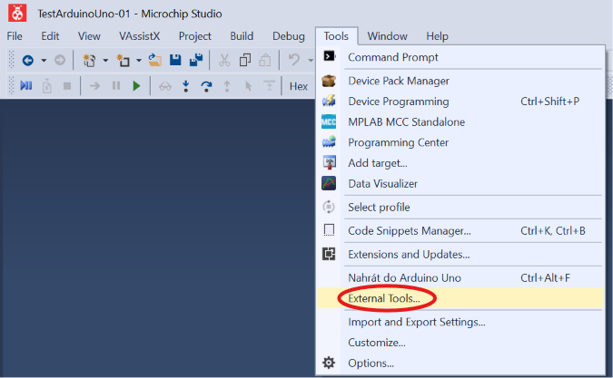
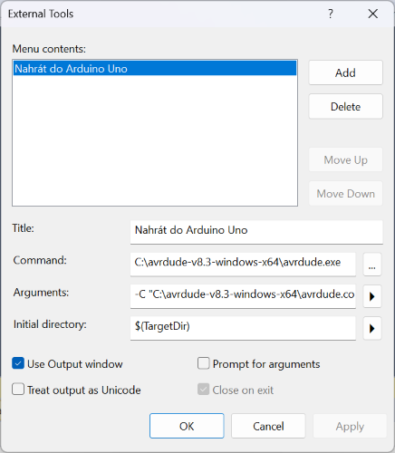
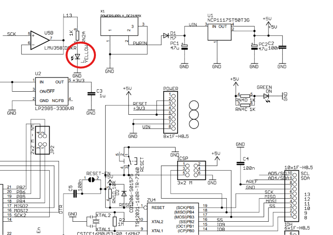

# Návod: Nastavení nahrávání z Microchip Studio do Arduino UNO (ATmega328P)

Tento návod slouží k nastavení automatického nahrávání zkompilovaného kód z **Microchip Studio** přímo do desky **Arduino UNO** přes sériovou linku (USB) pomocí nástroje `avrdude`.

---

## 0. Prerekvizity (Co musíte mít připraveno)

Než začnete nastavovat nahrávání, ujistěte se, že máte připraveny následující věci:

1. **Microchip Studio (v7.0):** Nainstalované vývojové prostředí pro AVR ([ke stažení na tomto webu](https://www.microchip.com/en-us/tools-resources/develop/microchip-studio)).
2. **Arduino UNO + USB kabel:**
   * **Precizní klon (např. ze sady dratek.cz s čipem ATmega16U2) nebo originál:** Ve Windows 10/11 **není potřeba ručně instalovat žádné ovladače** – systém desku rozpozná sám automaticky po zapojení do USB.
   * *(Poznámka: Pouze u levných čínských klonů s USB převodníkem CH340 je nutné mít nainstalovaný ovladač CH340).*
3. **Nástroj AVRDUDE:** Samostatný balíček pro nahrávání (postup stažení a rozbalení viz kapitola 1 níže).

---

## 1. Kde získat `avrdude` (bez instalace Arduino IDE)?

Pokud na svém počítači nemáte a nechcete instalovat celé prostředí Arduino IDE, stačí si stáhnout samostatný nástroj `avrdude`:

1. Stáhněte si samostatný balíček **AVRDUDE pro Windows** (např. z oficiálního [repozitáře GitHub](https://github.com/avrdudes/avrdude/releases), kde můžete vybrat balíček pro konkrétní systém, pokud používáte 64-bit Windows, můžete stáhnout avrdude [tímto přímým odkazem](https://github.com/avrdudes/avrdude/releases/download/v8.3/avrdude-v8.3-windows-x64.zip)).
2. Balíček rozbalte do jednoduché složky na disku `C:\`, například:
   `C:\avrdude\`
3. Ve složce musíte vidět dva klíčové soubory:
   * `avrdude.exe` (samotný spouštěcí program)
   * `avrdude.conf` (konfigurační soubor)

---

## 2. Zjištění čísla COM portu ve Windows

Před nastavením v Microchip Studiu musíte zjistit, na kterém portu je vaše Arduino připojeno:

1. Zapojte Arduino UNO USB kabelem do počítače.
2. Stiskněte klávesy **Win + X** a zvolte **Správce zařízení** (nebo stiskněte klávesu Windows, napište *Správce zařízení* a otevřete jej).
3. Rozbalte sekci **Porty (COM a LPT)**.
4. Najděte své zařízení – uvidíte například:  
   `Arduino Uno (COM4)` nebo `USB Serial Device (COM3)`.
5. Zapamatujte si číslo portu (např. **COM3** nebo **COM4**).

---

## 3. Nastavení v Microchip Studio (External Tools)

1. Spusťte **Microchip Studio**.
2. V hlavní horní liště klikněte na **Tools** &rarr; **External Tools...** (Pozor: Neotevírejte vlastnosti projektu, ale nabídku v horním menu!).


3. V okně klikněte na tlačítko **Add** a vyplňte následující políčka:

* **Title (Název):**  
  `Nahrát do Arduino Uno`
* **Command (Příkaz):**  
  `C:\avrdude\avrdude.exe` *(případně cesta, kde máte avrdude uložený)*
* **Arguments (Argumenty):**  
  `-C "C:\avrdude\avrdude.conf" -v -p atmega328p -c arduino -P COM3 -b 115200 -D -U flash:w:"$(ProjectDir)Debug\$(TargetName).hex":i`
  *(Poznámka: Hodnotu `-P COM3` upravte podle čísla vašeho portu ze Správce zařízení!)*
* **Initial directory (Výchozí adresář):**  
  `$(TargetDir)`
* Zaškrtněte políčko **Use Output window** (Použít okno výstupu).



4. Potvrďte kliknutím na tlačítko **OK**.

---

## 4. Postup nahrání programu do Arduina

Pro první testovací nahrání v **Microchip Studiu** je nejlepší použít jednoduchý kód v čistém C, který změní frekvenci blikání vestavěné LED diody (označené jako **L** na pinu **PB5 / pin 13** Arduina Uno, viz [schéma](files/Arduino_Uno_Rev3-schematic.pdf)). Poznáte tak okamžitě, že se tovární kód přepsal vaším vlastním programem.



1. Vytvořte v Microchip Studiu nový projekt (GCC C Executable Project) dle [standardního postupu](01_Uvod.md), zvolte mikrokontrolér **ATmega328P** a do souboru main.c vložte tento kód:

```c
#ifndef F_CPU
#define F_CPU 16000000UL    // Definice taktovací frekvence 16 MHz (nutné pro _delay_ms)
#endif

#include <avr/io.h>
#include <util/delay.h>

int main(void)
{
    // Nastavení pinu PB5 (vestavěná LED 'L') jako VÝSTUPNÍ
    // Registr DDRB otevírá port B (1 = výstup/otevřeno, 0 = vstup/zavřeno)
    DDRB |= (1 << DDB5);

    while (1) 
    {
        // Překlopení stavu LED (TOGGLE) pomocí XOR operátoru na registru PORTB
        PORTB ^= (1 << PORTB5);
        
        // Zpoždění 200 ms (rychlé blikání)
        _delay_ms(200);
    }
}
```

2. Přeložte projekt stisknutím klávesy **F7** (nebo menu *Build* &rarr; *Build Solution*). V dolním okně se musí objevit `Build succeeded`.
3. V horním menu klikněte na **Tools** &rarr; **Nahrát do Arduino Uno**.
4. V dolním okně *Output* uvidíte průběh nahrávání ukončený hláškou `avrdude done. Thank you.`.

---

## ⚠️ Důležitá upozornění a řešení problémů

* **Chyba `avrdude: stk500_getsync(): not in sync`:**  
  Máte špatně nastavené číslo COM portu v řádku *Arguments* (`-P COMx`), nebo nemáte Arduino zapojené v USB. Zkontrolujte Správce zařízení.
* **Nezapomeňte na parametr `-D`:**  
  Parametr `-D` zakazuje celkové smazání čipu před zápisem. **Nikdy ho nevynechávejte!** Bez něj by došlo ke smazání továrního zaváděcího programu (bootloaderu) v Arduinu.

## Video návod

<div style="position: relative; padding-bottom: 56.25%; height: 0; overflow: hidden; max-width: 100%;">
  <iframe style="position: absolute; top: 0; left: 0; width: 100%; height: 100%;" src="https://www.youtube.com/embed/geIcCHvqJ3o?si=bH258G7kDLBBlU3H" title="YouTube video player" frameborder="0" allow="accelerometer; autoplay; clipboard-write; encrypted-media; gyroscope; picture-in-picture" allowfullscreen></iframe>
</div>

## [Zpět na obsah](README.md)